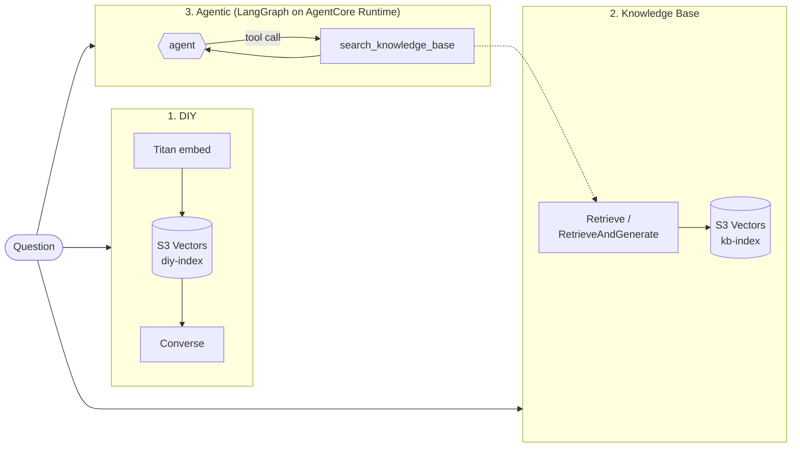

# RAG-approaches

Amazon Bedrock Knowledge Bases vs. AgentCore RAG vs. building RAG from scratch: which should you choose?

This repo implements the same question-answering system three ways on AWS. All three use the same corpus,
the same chunking, the same model and the same eval set, so differences in quality, latency and cost come from
the approach itself.

| # | Approach | You own | AWS manages |
|---|----------|---------|-------------|
| 1 | **DIY RAG** (`diy`) | chunking, embedding calls, vector index, retrieval, prompt | the model, the vector store (S3 Vectors) |
| 2 | **Bedrock Knowledge Bases** (`kb`, `kb-rag`) | the prompt (`kb`), or nothing (`kb-rag`) | ingestion, chunking, embedding, sync, retrieval |
| 3 | **Agentic RAG on AgentCore** (`agentic`, `agentcore`) | the agent graph and its tools | hosting, session isolation, scaling, observability |

> These aren't three alternatives on the same axis. 1 vs. 2 is about **retrieval** (build it or buy it).
> 3 is about **orchestration**: whether a fixed pipeline or an agent decides how to search. The agent's search
> tool uses the Knowledge Base by default (`AGENT_RETRIEVER=diy` switches it to the DIY index).



## Corpus (public documents only)

| Source | What | License note |
|--------|------|--------------|
| `wellarchitected` | [AWS Well-Architected Framework](https://docs.aws.amazon.com/wellarchitected/latest/framework/) | AWS documentation |
| `prescriptive-guidance` | 8 [AWS Prescriptive Guidance](https://docs.aws.amazon.com/prescriptive-guidance/) guides: 7 Rs, large migrations, DB migration, cloud design patterns, decomposing monoliths, Security Reference Architecture, RAG options, CloudWatch logging and monitoring | AWS documentation |
| `sre` | [Site Reliability Engineering](https://sre.google/sre-book/table-of-contents/) and [The Site Reliability Workbook](https://sre.google/workbook/table-of-contents/) | © Google, CC BY-NC-ND 4.0 |

Documents are **downloaded at runtime and never committed** (see [`corpus/manifest.yaml`](corpus/manifest.yaml)).
*The Phoenix Project* and *TOGAF* are deliberately excluded because they aren't openly licensed. The eval set asks
about both, to check that each approach says "not found" instead of answering from the model's memory.

## Repo layout

```
src/rag_approaches/
  approaches/diy.py               # 1. embed -> S3 Vectors QueryVectors -> Converse
  approaches/knowledge_base.py    # 2. Retrieve (+ our prompt) or RetrieveAndGenerate
  approaches/agentic.py           # 3. LangGraph agent with a search tool
  approaches/agentcore_remote.py  # 3. same agent, invoked on AgentCore Runtime
  llm.py  chunking.py  corpus.py  pricing.py  evaluation.py  cost_model.py  cli.py
agent/main.py                     # AgentCore Runtime entrypoint
app/streamlit_app.py              # chat UI with retrieved chunks, trace, tokens, cost
infra/terraform/                  # S3, S3 Vectors, KB + data source, AgentCore runtime, IAM
eval/questions.jsonl              # 31 questions: single-hop, multi-hop, filtered, unanswerable
config/pricing.yaml               # unit prices (verify before publishing!)
docs/blog-outline.md
```

## Quick start

Prerequisites: [uv](https://docs.astral.sh/uv/), Terraform >= 1.10, AWS CLI v2 logged in
(`aws login`), and an account where Bedrock, S3 Vectors and AgentCore are available in your Region.

```powershell
uv sync
cp .env.example .env

# 1. Corpus
uv run rag download
uv run rag prepare

# 2. Infrastructure (build the agent package first so Terraform can deploy it)
uv run python scripts/build_agent_package.py
cp infra/terraform/terraform.tfvars.example infra/terraform/terraform.tfvars
terraform -chdir=infra/terraform init
terraform -chdir=infra/terraform apply
uv run rag tf-outputs

# 3. Load both indexes
uv run rag index-diy
uv run rag kb-upload
uv run rag kb-sync

# 4. Try it
uv run rag ask -a diy "What are the four golden signals?"
uv run rag ask -a agentic "Compare how Well-Architected and the SRE book approach disaster recovery testing"
uv run streamlit run app/streamlit_app.py

# 5. Measure
uv run rag eval -a diy,kb,kb-rag,agentic,agentcore
uv run rag cost-model --vectors 30000
```

### Tear down

Nothing here runs a cluster, so idle cost is close to zero: S3 and S3 Vectors storage plus CloudWatch logs.
Still, remove everything when you're done:

```powershell
terraform -chdir=infra/terraform destroy
```

## Fairness rules

- **Same input:** the DIY index and the KB both ingest the same processed `.txt` files with the same metadata.
- **Same chunking:** fixed-size chunks of about 300 tokens with 20% overlap for both.
- **Same model and prompt:** `diy` and `kb` share `llm.SYSTEM_PROMPT`, so only retrieval differs.
  `kb-rag` uses the managed prompt, which is part of what's being compared.
- **Same vector store:** both use S3 Vectors, so the KB's managed pipeline is measured rather than a different database.
  `rag cost-model` also shows what the KB would cost on OpenSearch Serverless.
- **Measured, not guessed:** latency and tokens come from API responses. Where AWS doesn't report tokens
  (RetrieveAndGenerate), the result is flagged `estimated`.
