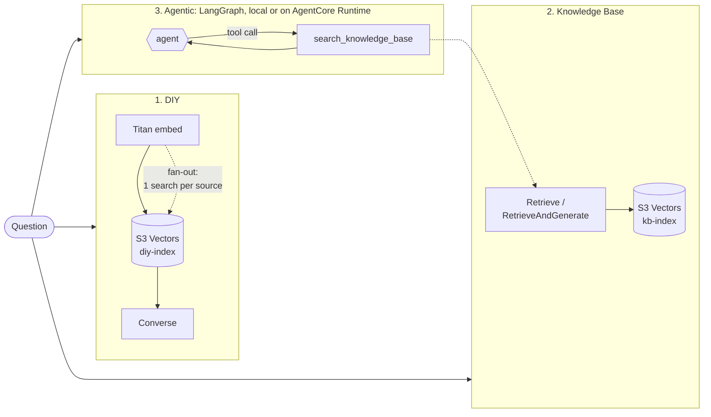

# RAG-approaches

Amazon Bedrock Knowledge Bases vs. AgentCore RAG vs. building RAG from scratch: which should you choose?

This repo builds the same question-answering system **six ways in three families** on AWS. Every approach uses
the same corpus, chunking, model, prompt (where applicable) and eval set, and returns the same result shape, so
differences in quality, latency and cost come from the approach itself.

## The approaches

| Family | Key (`-a`) | What it does | Searches | LLM calls | You own | AWS manages |
|---|---|---|---|---|---|---|
| **1. DIY RAG** | `diy` | Embed question → one S3 Vectors search → one model call | 1 | 1 | chunking, embedding calls, index, retrieval, prompt, retries and quotas | the model and the vector store |
| | `diy-fanout` | Embed once → **one filtered search per source** → merge → one model call | 3 | 1 | same as `diy` | same as `diy` |
| **2. Bedrock Knowledge Bases** | `kb` | KB `Retrieve` + **the same prompt as `diy`** (only retrieval differs) | 1 | 1 | the prompt | ingestion, chunking, embedding, sync, retrieval |
| | `kb-rag` | KB `RetrieveAndGenerate`: fully managed, one call | 1 | 1 | nothing | everything, including the prompt |
| **3. Agentic RAG** | `agentic` | LangGraph agent; retrieval is a **tool** it calls as it sees fit (rewrite, filter per source, search again) | 1–4 | 2–3 | the agent graph and tools | the KB it searches |
| | `agentcore` | The **same agent** hosted on Amazon Bedrock AgentCore Runtime | 1–4 | 2–3 | the agent graph and tools | hosting, session isolation (microVMs), scaling, observability |

> **These aren't alternatives on one axis.** Family 1 vs. 2 is about **retrieval**: build it or buy it.
> Family 3 is about **orchestration**: whether a fixed pipeline or the model decides how to search, and the agent
> searches *through* the Knowledge Base (`AGENT_RETRIEVER=diy` switches it to the DIY index). `diy-fanout` is the
> control for the agent: it borrows the agent's per-source searching without the agent loop, which separates
> "better search strategy" from "agency".
> `agentic` vs. `agentcore` isolates the cost of managed hosting: identical code, local vs. AgentCore.



**Current deployment:** `ap-southeast-2` (Sydney), Claude Sonnet 4.6 via the `au.` inference profile, and Titan Text
Embeddings V2 (1,024 dims). All six approaches pass smoke tests; the full eval hasn't been run yet. See
[`docs/PROGRESS.md`](docs/PROGRESS.md) for exact status and steps, and
[`docs/blog-outline.md`](docs/blog-outline.md) for findings so far (e.g. why the agent wins cross-source questions).

## Corpus (public documents only)

| Source | What | License note |
|--------|------|--------------|
| `wellarchitected` | [AWS Well-Architected Framework](https://docs.aws.amazon.com/wellarchitected/latest/framework/) | AWS documentation |
| `prescriptive-guidance` | 8 [AWS Prescriptive Guidance](https://docs.aws.amazon.com/prescriptive-guidance/) guides: 7 Rs, large migrations, DB migration, cloud design patterns, decomposing monoliths, Security Reference Architecture, RAG options, CloudWatch logging and monitoring | AWS documentation |
| `sre` | [Site Reliability Engineering](https://sre.google/sre-book/table-of-contents/) and [The Site Reliability Workbook](https://sre.google/workbook/table-of-contents/) | © Google, CC BY-NC-ND 4.0 |

79 documents, about 4,200–4,500 chunks per index. Documents are **downloaded at runtime and never committed** (see
[`corpus/manifest.yaml`](corpus/manifest.yaml)). *The Phoenix Project* and *TOGAF* are deliberately excluded
because they aren't openly licensed. The eval set asks about both, to check that each approach says "not found"
instead of answering from the model's memory.

## Repo layout

```
src/rag_approaches/
  approaches/diy.py               # 1. diy + diy-fanout: embed -> S3 Vectors QueryVectors -> Converse
  approaches/knowledge_base.py    # 2. kb (Retrieve + our prompt) and kb-rag (RetrieveAndGenerate)
  approaches/agentic.py           # 3. agentic: LangGraph agent with a search tool
  approaches/agentcore_remote.py  # 3. agentcore: same agent, invoked on AgentCore Runtime
  llm.py  chunking.py  corpus.py  pricing.py  evaluation.py  cost_model.py  cli.py  types.py
agent/main.py                     # AgentCore Runtime entrypoint (wraps the same agent)
app/streamlit_app.py              # chat + side-by-side compare: retrieved chunks, trace, tokens, cost
scripts/build_agent_package.py    # builds the ARM64 code zip for AgentCore direct code deployment
infra/terraform/                  # S3, S3 Vectors (2 indexes), KB + data source, AgentCore runtime, IAM
eval/questions.jsonl              # 31 questions: single-hop, multi-hop, filtered, unanswerable
config/pricing.yaml               # unit prices (verify before publishing!)
docs/PROGRESS.md                  # step-by-step log of what's been done; start here when resuming
docs/blog-outline.md              # blog structure + findings so far
```

## Quick start

Prerequisites: [uv](https://docs.astral.sh/uv/), Terraform >= 1.10, AWS CLI v2 logged in
(`aws login`), and an account where Bedrock, S3 Vectors and AgentCore are available in your Region.

```powershell
uv sync
cp .env.example .env

# 1. Corpus
uv run rag download
uv run rag prepare

# 2. Infrastructure (build the agent package first so Terraform can deploy it)
uv run python scripts/build_agent_package.py
cp infra/terraform/terraform.tfvars.example infra/terraform/terraform.tfvars
terraform -chdir=infra/terraform init
terraform -chdir=infra/terraform plan -out=tfplan      # review before applying
terraform -chdir=infra/terraform apply tfplan
uv run rag tf-outputs

# 3. Load both indexes, one after the other: they share the embedding quota
uv run rag kb-upload
uv run rag kb-sync
uv run rag index-diy          # paced to 500 req/min; resumable

# 4. Try it
uv run rag ask -a diy "What are the four golden signals?"
uv run rag ask -a diy-fanout "How do the AWS Well-Architected Framework and the Google SRE book each recommend learning from incidents?"
uv run rag ask -a agentic "How do the AWS Well-Architected Framework and the Google SRE book each recommend learning from incidents?"
uv run streamlit run app/streamlit_app.py       # "Compare approaches" mode shows them side by side

# 5. Measure
uv run rag eval -a diy,diy-fanout,kb,kb-rag,agentic,agentcore
uv run rag cost-model --vectors 4500
```

### Tear down

Nothing here runs a cluster, so an idle deployment costs **under $0.01 a week** (S3 and S3 Vectors storage). The
Knowledge Base and the AgentCore runtime cost nothing when idle. Still, remove everything when you're done:

```powershell
terraform -chdir=infra/terraform destroy
```

## Fairness rules

- **Same input:** the DIY index and the KB both ingest the same processed `.txt` files with the same metadata.
- **Same chunking:** fixed-size chunks of about 300 tokens with 20% overlap for both.
- **Same model and prompt:** `diy`, `diy-fanout` and `kb` share `llm.SYSTEM_PROMPT`, so only retrieval differs.
  `kb-rag` uses the managed prompt and `agentic`/`agentcore` use an agent prompt; those differences are part of
  what's being compared.
- **Same vector store:** both indexes use S3 Vectors, so the KB's managed pipeline is measured rather than a
  different database. `rag cost-model` also shows what the KB would cost on OpenSearch Serverless.
- **Same output budget:** `max_tokens=2048` for every approach.
- **Context is reported, not hidden:** approaches read different amounts of retrieved text (5 vs. 15 chunks), so the
  eval reports average context chunks and tokens and multi-hop source coverage alongside correctness.
- **Warm vs. cold:** AgentCore sessions have a ~5 s cold start; the chat app reuses one session per conversation.
- **Measured, not guessed:** latency and tokens come from API responses. Where AWS doesn't report tokens
  (RetrieveAndGenerate), the result is flagged `estimated`.
